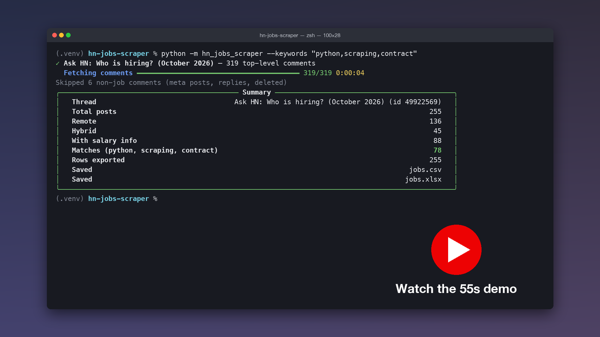
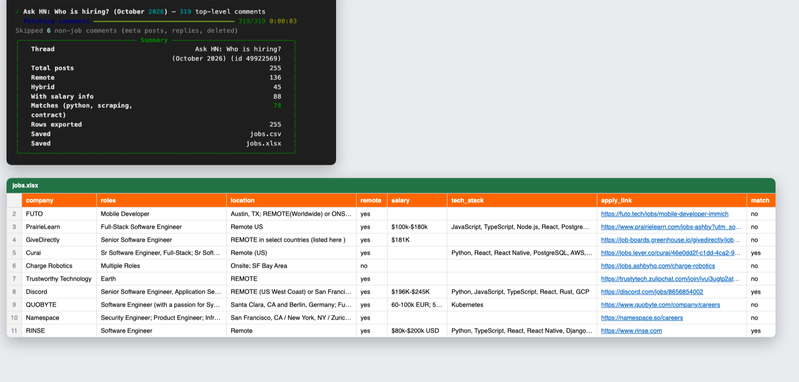

# hn-jobs-scraper

**Turn the latest Hacker News "Ask HN: Who is hiring?" thread into a clean, filterable spreadsheet in about five seconds.**

[](https://youtu.be/vXRHD_D9cBk)

▶ **[Watch the 55-second demo](https://youtu.be/vXRHD_D9cBk)**: one command, then the progress bar, the summary, and the finished spreadsheet.



---

## Features

- **API-only, no HTML scraping.** Finds the newest thread posted by `whoishiring` through the [Algolia HN Search API](https://hn.algolia.com/api), then pulls every top-level comment from the [official HN API](https://github.com/HackerNews/API).
- **Fast and polite async fetching.** Uses `httpx` + `asyncio` with at most 20 concurrent requests, plus exponential-backoff retries on timeouts, 429s and 5xx errors.
- **Structured parsing.** Each post becomes these columns:

  | Column | Example |
  |---|---|
  | `company` | Discord |
  | `roles` | Senior Software Engineer, Application Security |
  | `location` | REMOTE (US West Coast) or San Francisco, CA |
  | `remote` | `yes` / `no` / `hybrid` |
  | `job_type` | Full-time, Contract |
  | `salary` | $196K-$245K |
  | `tech_stack` | Python, TypeScript, React, Rust, GCP |
  | `apply_link` / `apply_email` | careers page, Greenhouse/Lever/Ashby link, or a de-obfuscated `name [at] co [dot] com` |
  | `posted` | 2026-10-01 |
  | `hn_url` | https://news.ycombinator.com/item?id=... |

- **Keyword matching.** `--keywords "python,scraping,contract"` adds `match` and `matched_keywords` columns. Add `--only-matches` to export only the hits.
- **Spreadsheet output.** Writes `jobs.csv` (UTF-8 with BOM, so Excel opens it cleanly) and `jobs.xlsx` with a bold, frozen header row, auto-filter, auto-sized columns and clickable URLs and emails.
- **Optional Google Sheets push** with `gspread` and a service account.
- **Rich terminal UI.** Shows a live progress bar and a summary panel with total posts, remote/hybrid counts, posts with salary info and keyword matches.
- **Noise filtering.** Meta comments, job-seeker replies, and deleted or flagged posts are skipped.
- **Tested parser.** The parser has `pytest` tests built on realistic sample comments.

## Setup

Requires Python 3.10+.

```bash
git clone https://github.com/Future6524/hn-jobs-scraper.git
cd hn-jobs-scraper
python -m venv .venv
source .venv/bin/activate        # Windows: .venv\Scripts\activate
pip install -r requirements.txt
```

## Usage

```bash
# Export the latest thread to ./jobs.csv and ./jobs.xlsx
python -m hn_jobs_scraper

# Flag posts that mention any of these keywords (prefix match: "contract" also hits "contractor")
python -m hn_jobs_scraper --keywords "python,scraping,contract"

# Only remote/hybrid posts that match, written to ./output/
python -m hn_jobs_scraper --keywords "python,django" --only-matches --remote-only --out-dir output

# A specific past thread, first 50 comments only (handy for quick demos)
python -m hn_jobs_scraper --thread-id 49922569 --limit 50

# Also push the rows to a Google Sheet
export GOOGLE_SHEETS_CREDENTIALS=~/keys/service-account.json   # path or raw JSON
python -m hn_jobs_scraper --keywords "python" --sheet-id 1AbC...xyz
```

| Flag | Description |
|---|---|
| `--keywords` | Comma-separated keywords; adds `match` / `matched_keywords` columns |
| `--only-matches` | Export only rows that match `--keywords` |
| `--remote-only` | Export only `remote = yes/hybrid` rows |
| `--thread-id` | Use a specific thread instead of the newest one |
| `--limit` | Process only the first N top-level comments |
| `--out-dir` | Output directory (default `.`) |
| `--concurrency` | Max parallel requests (default `20`) |
| `--sheet-id` | Google Sheet ID to push to (needs `GOOGLE_SHEETS_CREDENTIALS`) |

**Google Sheets:** create a service account in Google Cloud, enable the Sheets API, download its JSON key, and share your sheet with the service account's email as an Editor. Each run replaces the contents of the `Jobs` worksheet.

### Example run

```text
✓ Ask HN: Who is hiring? (October 2026) — 319 top-level comments
  Fetching comments ━━━━━━━━━━━━━━━━━━━━━━━━━━━━━━━━━━━━━━━━ 319/319 0:00:05
Skipped 6 non-job comments (meta posts, replies, deleted)
╭──────────────────────────── Summary ────────────────────────────╮
│   Thread                Ask HN: Who is hiring? (October 2026)   │
│   Total posts                                             255   │
│   Remote                                                  136   │
│   Hybrid                                                   45   │
│   With salary info                                         88   │
│   Matches (python, scraping, contract)                     78   │
│   Rows exported                                           255   │
│   Saved                                              jobs.csv   │
│   Saved                                             jobs.xlsx   │
╰─────────────────────────────────────────────────────────────────╯
```

## Sample output

The first rows from the October 2026 thread, run with `--keywords "python,scraping,contract"`:

| company | roles | location | remote | salary | tech_stack | match |
|---|---|---|---|---|---|---|
| FUTO | Mobile Developer | Austin, TX; REMOTE(Worldwide) or ONSITE | yes | | | no |
| PrairieLearn | Full-Stack Software Engineer | Remote US | yes | $100k-$180k | JavaScript, TypeScript, Node.js, React, PostgreSQL, AWS, LLM | no |
| GiveDirectly | Senior Software Engineer | REMOTE in select countries | yes | $181K | | no |
| Curai | Sr Software Engineer, Full-Stack; Sr Software Engineer, Agentic AI | Remote (US) | yes | | Python, React, React Native, PostgreSQL, AWS, Docker, Terraform | yes |
| Discord | Senior Software Engineer, Application Security | REMOTE (US West Coast) or San Francisco, CA | yes | $196K-$245K | Python, JavaScript, TypeScript, React, Rust, GCP | yes |
| QUOBYTE | Software Engineer; Customer Success Engineer | Santa Clara, CA and Berlin, Germany | yes | 60-100k EUR; 50-90k | Kubernetes | no |
| RINSE | Software Engineer | Remote | yes | $80k-$200k USD | Python, TypeScript, React, React Native, Django, PostgreSQL | yes |

## Project layout

```text
hn_jobs_scraper/
  api.py      # async HN + Algolia client (retries, concurrency limit)
  parser.py   # comment HTML -> JobPost (company, roles, salary, stack, ...)
  export.py   # CSV, formatted XLSX, Google Sheets
  cli.py      # argparse + rich progress/summary
tests/
  test_parser.py
```

## Running tests

```bash
pytest -q
```

## How parsing works

Most posts start with a header like `Company | Role | Location | Full-time | $150k`. The parser splits the header on `|` (falling back to ` - ` or ` — `). Each segment is classified as a role, location, job type, salary or tech stack, using small vocabularies and regexes. Fields the header doesn't cover are filled in from the body:

- the remote policy, including negations like "no remote"
- the salary, skipping funding amounts like "$20M Series A"
- the tech stack, from a list of about 60 technologies
- role titles listed as bullets
- apply links, preferring careers, Greenhouse, Lever and Ashby URLs
- emails, de-obfuscating forms like `name [at] company [dot] com`

Free-text job posts are messy, so expect roughly 90% accuracy, not perfection. Every row links back to the original comment.

## License

[MIT](LICENSE)

---

## Need a custom scraper?

I build reliable, maintainable scrapers and data pipelines: job boards, e-commerce catalogs, real-estate listings, lead lists, and price monitoring. Delivery is CSV, Excel, Google Sheets, a database or an API.

**Contact me on Reddit: [u/PRETTYsaveliev](https://www.reddit.com/user/PRETTYsaveliev)**
